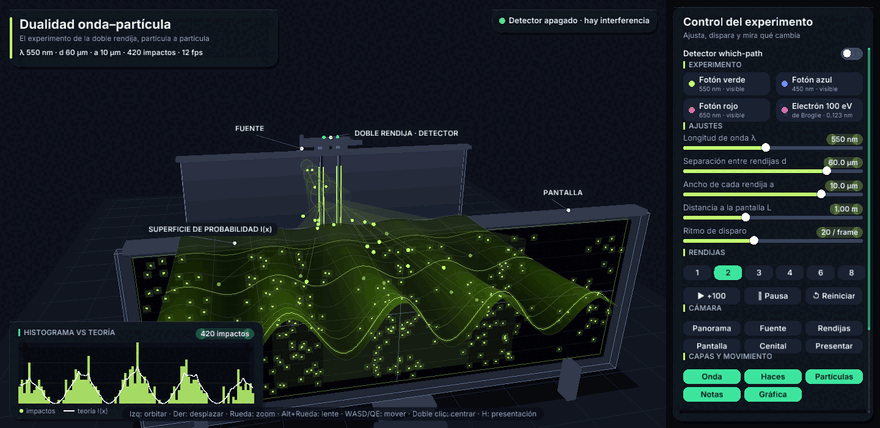

# Dualidad Onda-Partícula

Simulador interactivo del **experimento de la doble rendija**: partículas disparadas
**una por una** que, al acumularse, forman un patrón de interferencia ondulatorio.

> **Estado del proyecto:** v0.6.0 en desarrollo — motor 3D con panel de
> control por ratón, presets de partículas (fotón/electrón de Broglie),
> 1–8 rendijas, capas, cámara libre con zoom suave y modo presentación.
> CI activa.
> Consulta el estado real en [`docs/05-roadmap.md`](docs/05-roadmap.md).

Repositorio original: [omarPVP123131/Dualidad-Onda-Fisica](https://github.com/omarPVP123131/Dualidad-Onda-Fisica)



## Autores

- Omar Palomares Velasco
- Leonardo Miguel Vega Carbajal

Proyecto escolar/universitario. Materia, institución, grupo y docente: **por completar**
en [`docs/07-entrega-escolar.md`](docs/07-entrega-escolar.md).

## Qué hace hoy (v0.3.0)

- **Escena 3D orbitable** (macroquad 3D): fuente, barrera con dos rendijas,
  sensores del detector y pantalla en un laboratorio virtual.
- **Superficie 3D de `I(x)`** que crece desde las rendijas hasta la pantalla,
  en el color de la longitud de onda λ.
- Doble rendija con difracción de Fraunhofer: envolvente de una rendija × interferencia de dos.
- Disparo partícula por partícula; cada impacto se muestrea según |ψ|², se ve
  **volar por la escena** y queda marcado en la pantalla 3D.
- **Histograma en panel de datos** comparado en vivo con la curva teórica (línea blanca), legible sin deformación por la perspectiva.
- Detector *which-path*: al activarlo (`O`) desaparece la interferencia.
- **Panel CONTROL con ratón**: sliders de λ, `d`, `a`, `L` y ritmo; número de
  rendijas (1–8); detector, pausa, disparos manuales y reinicio.
- **Presets reales**: fotones azul/verde/rojo y **electrón de 100 eV** con
  λ de de Broglie (0.123 nm) y experimento reescalado.
- **Cámara libre con zoom suave**: órbita, desplazamiento del centro y
  zoom 0.8–48 u con inercia (rueda, arrastre o deslizador del panel),
  lente ajustable (Alt+rueda), vistas guardadas con vuelo animado y
  modo guiado opcional para no perder el experimento de cuadro.
- Capas activables, órbita cinemática, **modo presentación** (`H` o
  botón) y teclado completo como respaldo.
- Física sin dependencias gráficas: el núcleo es testeable sin abrir ventana (41 tests).

La explicación física completa está en [`docs/02-fisica.md`](docs/02-fisica.md).
**En esta formalización no se modificó la física ni el código.**

## Requisitos

- [Rust](https://www.rust-lang.org/tools/install) (toolchain estable) y `Cargo`.
- En Linux pueden requerirse librerías de desarrollo X11/OpenGL y ASLA; el detalle
  por sistema operativo está en [`docs/04-instalacion-y-desarrollo.md`](docs/04-instalacion-y-desarrollo.md).

## Instalación y ejecución

```bash
git clone https://github.com/omarPVP123131/Dualidad-Onda-Fisica.git
cd Dualidad-Onda-Fisica
cargo run --release
```

> En la formalización se renombró el manifiesto a `Cargo.toml` (con mayúscula,
> como busca Cargo en Linux/macOS/CI). El contenido del archivo no cambió ni
> una línea. Detalle en `CHANGELOG.md` y `docs/04-instalacion-y-desarrollo.md`.

## Controles actuales

| Tecla | Acción |
|---|---|
| `↑` / `↓` | Aumentar / disminuir λ |
| `←` / `→` | Disminuir / aumentar la separación `d` |
| `W` / `A` / `S` / `D` (+ `Q` / `E`) | Mover la cámara por la escena (avanzar, izquierda, atrás, derecha; bajar y subir). Mayús: 3× más rápido |
| `O` | Activar / desactivar el detector *which-path* |
| `+` / `-` | Duplicar / reducir el ritmo de disparo |
| `Espacio` | Pausar / reanudar |
| `R` | Reiniciar la pantalla |
| `C` o doble clic | Restablecer la cámara 3D (vuelo suave) |
| Arrastrar (botón izq.) | Orbitar la cámara |
| Arrastrar (botón der. o Mayús+izq.) | Desplazar el centro de interés |
| Rueda del ratón | Zoom suave (0.8–32 u); sobre el panel, desplaza la lista de controles |
| `Alt` + rueda | Ajustar la lente (campo de visión 20°–70°) |
| Panel CONTROL | Sliders, presets, rendijas, capas y vistas con el ratón. Barra de desplazamiento: rueda o arrastre |
| `H` | Modo presentación (ocultar/mostrar la interfaz) |

## Documentación

Empieza por el índice: [`docs/00-indice.md`](docs/00-indice.md)

| Documento | Para qué sirve |
|---|---|
| `docs/01-vision-y-alcance.md` | Qué es, qué no es y para quién |
| `docs/02-fisica.md` | Modelo, ecuaciones, supuestos y límites |
| `docs/03-arquitectura-actual.md` | Mapa honesto del código actual, línea por línea |
| `docs/04-instalacion-y-desarrollo.md` | Instalar, correr y diagnosticar |
| `docs/05-roadmap.md` | **Roadmap por fases hasta la entrega y el 3D** |
| `docs/06-diseno-3d.md` | Plantilla para que los autores definan el 3D |
| `docs/07-entrega-escolar.md` | Checklist de entrega, informe y demo |
| `docs/08-riesgos-y-deuda-tecnica.md` | Riesgos y deuda técnica sin maquillaje |
| `docs/09-preguntas-abiertas.md` | **Preguntas que los autores deben responder** |
| `docs/10-glosario-y-referencias.md` | Glosario y bibliografía |
| `docs/decisiones/` | Registro de decisiones (ADR) |

## Estructura

```
.
├── Cargo.toml                # workspace: raíz virtual, sin paquete propio
├── Cargo.lock
├── crates/
│   ├── dualidad-core/        # crate: física N rendijas, presets, muestreo — sin gráficos
│   ├── dualidad-engine3d/    # crate: cámara, escena 3D, panel de control, HUD y gráfica
│   └── dualidad-app/         # crate: binario `dualidad` (entrada, teclado, bucle)
├── docs/                     # documentación, roadmap, decisiones y plantillas
├── LICENSE                   # GPL-3.0 (texto oficial íntegro)
└── LICENCIAS.md              # la licencia explicada en español claro
```

## Licencia

**GNU GPL v3.0 o posterior** (`GPL-3.0-or-later`) — ver [`LICENSE`](LICENSE).
Copyright © 2026 Omar Palomares Velasco y Leonardo Miguel Vega Carbajal. Quien distribuya
versiones modificadas debe mantenerlas bajo la misma licencia (copyleft).
Explicado en español claro en [`LICENCIAS.md`](LICENCIAS.md) y decidido en
`docs/decisiones/ADR-0003-licencias.md`.
