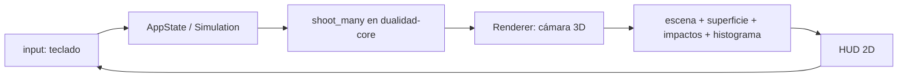

# 03 · Arquitectura actual (por crates)

> Estado desde v0.2.0. El monolito original de 173 líneas se eliminó y se
> reescribió en un **workspace Cargo por crates bajo `src/`**. La física y
> los controles del prototipo se conservaron; la organización, no.

## Mapa del workspace

```
Cargo.toml                      # workspace virtual (sin paquete raíz)
src/
├── dualidad-core/              # CRATE 1 · física pura, cero gráficos
│   └── src/
│       ├── params.rs           # SimulationParams y rangos (SI)
│       ├── physics.rs          # I(x) = sinc²(β)·cos²(δ), curva teórica
│       ├── simulation.rs       # Simulation, Impact, muestreo por rechazo
│       ├── histogram.rs        # bins, totales, conteos esperados
│       ├── rng.rs              # SplitMix64 propio (reproducible, testeable)
│       └── color.rs            # λ visible → RGB puro
├── dualidad-engine3d/          # CRATE 2 · motor 3D sobre dualidad-core
│   └── src/
│       ├── camera.rs           # OrbitCamera (arrastre + rueda, con límites)
│       ├── scene.rs            # laboratorio: fuente, rendijas, pantalla
│       ├── wave_surface.rs     # superficie I(x) en malla por tiras
│       ├── impacts.rs          # impactos en mallas por lotes (máx. 40 000)
│       ├── particles.rs        # partículas en vuelo (visual esquemático)
│       ├── hud.rs              # paneles 2D: estado, lectura, ayuda e histograma vs teoría
│       ├── controls.rs         # dock de control: sliders, presets, vistas y capas
│       ├── ui.rs               # sistema de diseño: Inter incrustada, paneles, switches
│       ├── beams.rs            # haces translúcidos fuente/rendijas/pantalla
│       ├── annotations.rs      # etiquetas proyectadas de cada elemento de la escena
│       └── renderer.rs         # orquesta cámara → escena → datos → HUD
└── dualidad-app/               # CRATE 3 · binario `dualidad`
    └── src/
        ├── main.rs             # ventana, bucle, semilla, composición
        ├── state.rs            # AppState (simulación, ritmo, pausa)
        └── input.rs            # teclado → acciones (controles del prototipo + C)
```

## Regla de dependencias (no romper)

```
dualidad-app ──▶ dualidad-engine3d ──▶ dualidad-core
      └──────────────▶ dualidad-core
```

- `dualidad-core` **no** depende de macroquad: se testea sin ventana.
- `dualidad-engine3d` depende de core y macroquad, nunca de la app.
- `dualidad-app` es la única que conoce la ventana: pega estado, entrada y render.
- Si un cambio «necesita» que core conozca un color de macroquad o un Vec3:
  está mal ubicado. Muévelo de crate.

## Flujo por frame



## Decisiones de rendimiento ya tomadas

- macroquad recorta cada geometría a 5 000 índices: la superficie se
  divide en tiras y los impactos en mallas de 800 quads (verificado en ejecución).
- La superficie de `I(x)` solo se reconstruye si cambió λ, `d`, `a` o el detector.
- El histograma se agrega de 500 a 96 barras visuales, conservando el total.
- RNG propio con semilla: reproducible en tests, distinta en cada sesión
  (la app siembra desde el reloj).

## Tests (31, todos en verde)

| Crate | Qué cubre |
|---|---|
| dualidad-core (21) | I(x) con 1–N rendijas, de Broglie del electrón, presets, histograma, rangos, muestreo y emergencia del patrón |
| dualidad-engine3d (11) | cámara, barrera, haces, malla de onda y autoajuste de calidad por fps |
| dualidad-app (1) | saturación del ritmo de disparo |

```bash
cargo test --workspace
cargo clippy --workspace --all-targets -- -D warnings
cargo build --release   # ejecutable: target/release/dualidad
```

## Dónde tocar según la tarea

| Quiero cambiar… | Crate / archivo |
|---|---|
| Una fórmula o un nuevo modo físico | `dualidad-core` (+ tests + doc. 02) |
| Cómo se ve la escena, cámara o mallas | `dualidad-engine3d` |
| Teclas, ritmo, tamaño de ventana | `dualidad-app` |
