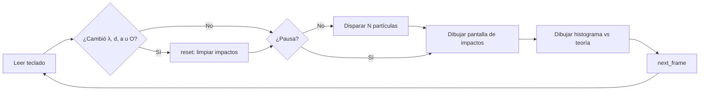

# 03 · Arquitectura actual (mapa del prototipo)

> Radiografía honesta de la v0.1.0 para que los autores sepan dónde está todo
> **antes** de reestructurar o construir el 3D. No describe un diseño ideal:
> describe el que existe hoy.

## Vista general

Todo el programa es **un solo archivo**: `src/main.rs` (173 líneas), con la
dependencia `macroquad = "0.4"` (gráficos 2D, ventana, teclado y azar).
No hay módulos, no hay tests, no hay archivos de configuración adicionales.

```
src/main.rs
├── Constantes ..................... BINS, HALF_W, MAX_DOTS
├── struct Sim ..................... estado + física + muestreo
│   ├── Sim::new() ................. valores iniciales
│   ├── Sim::reset() ............... limpia histograma y puntos
│   ├── Sim::intensity(x) .......... I(x) de Fraunhofer (+ modo detector)
│   └── Sim::shoot() ............... un impacto por muestreo por rechazo
├── wavelength_color(λ) ............ λ 380–750 nm → color RGB aproximado
├── window_conf() .................. ventana 1000×700
└── main() ......................... bucle: teclado → disparos → dibujo → frame
```

## Flujo de cada frame



## Constantes que mandan

| Constante | Valor | Efecto |
|---|---|---|
| `BINS` | 500 | Resolución del histograma |
| `HALF_W` | 0.02 m | Semiancho de pantalla (±20 mm) |
| `MAX_DOTS` | 40 000 | Máximo de puntos guardados para dibujar (el histograma sigue contando) |

## Límites y notas de lectura (ver detalle en el doc. 08)

- Al cambiar λ, `d`, `a` o el detector, los impactos se reinician: no se
  mezclan distribuciones distintas. Correcto didácticamente.
- La curva teórica se recalcula **cada frame** sobre los 500 bins (incluye una
  suma completa de normalización). Funciona, pero es trabajo repetido que un
  futuro refactor debería evitar — documentado, no corregido.
- `L` está fija en 1.0 m y no tiene control; `rate` y `paused` viven fuera
  de `Sim`, en el `main`.
- La física y el dibujo conviven en el mismo archivo/módulo: para crecer
  (3D, tests) habrá que separarlas. El orden sugerido está en el roadmap.

## Dependencias

| Crate | Uso | Estado |
|---|---|---|
| `macroquad 0.4` | Ventana, dibujo 2D, entrada, azar | Único crate directo; el resto de `Cargo.lock` es transitivo |

## Cómo orientarse para su primer cambio

1. Léete `Sim::intensity` + el doc. 02: ahí vive toda la física.
2. Léete el bloque «Controles» del `main`: ahí vive toda la interacción.
3. Léete el bloque «Dibujo»: es lo que el 3D algún día reemplazará o complementará.
   Ojo: reemplazar el dibujo sin tocar `Sim` debería ser posible si primero
   se separan física y presentación (Fase 1 del roadmap).
